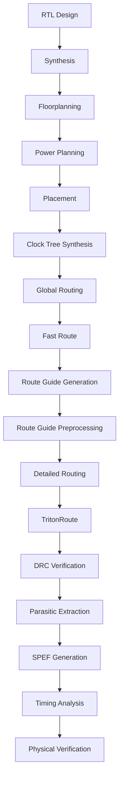

<h1 align="center">Module 5 · Wiring It All Together</h1>
<p align="center"><b>Routing, DRC, Parasitics and TritonRoute on SKY130</b><br>
<i>OpenLane · OpenROAD · Magic · OpenSTA</i></p>

---

## 🗺️ The Big Picture

Once cells are placed and the clock is built, the chip still has no wires. This module covers what happens next: connecting every pin with metal, proving the wiring obeys the foundry's rules, and measuring the unwanted resistance and capacitance the wires bring along.

Everything was carried out with the OpenLane flow on the SKY130 130 nm process.

**Topics in this module**

| Area | Items |
|---|---|
| **Routing theory** | Global/fast routing, detailed routing, Lee's maze algorithm |
| **Rule checking** | DRC, minimum wire width, via spacing |
| **TritonRoute** | Route guides, panel routing, access points, topology |
| **Post-route** | Parasitic extraction, SPEF generation |
| **OpenLane practice** | Floorplan, config parameters, run directories |

## 🧰 Toolbox

| Tool | What it did here |
|---|---|
| OpenLane | Drove the RTL-to-GDSII flow |
| SKY130 | Supplied the 130 nm process and rules |
| TritonRoute | Performed detailed, rule-aware routing |
| OpenROAD | Implementation and optimization engine |
| OpenSTA | Timing analysis |
| Magic | Layout viewing and rule checking |
| LEF | Physical library data |
| DEF | Physical design data |
| SPEF | Container for extracted parasitics |
| Ubuntu on VirtualBox | Environment the flow ran in |
| GitHub | Version control and documentation |

## 📑 Quick Jump

**Part I · Theory and checks:** [Routing](#-1-what-routing-does) · [Maze routing](#-2-lees-maze-routing) · [DRC](#-3-design-rule-checking) · [Parasitics](#-4-parasitic-extraction)

**Part II · The OpenLane run:** [Flow](#-5-the-openlane-flow) · [Floorplan](#-6-floorplan-and-power) · [Config](#-7-configuration-and-execution) · [Routing output](#-8-routing-output)

**Part III · TritonRoute in depth:** [Fast vs detailed](#-9-fast-route-vs-detailed-route) · [TritonRoute](#-10-meet-tritonroute) · [Guides](#-11-route-guides) · [Panels](#-12-panel-routing) · [Problem](#-13-the-problem-statement) · [Connectivity](#-14-connectivity-and-access-points) · [Topology](#-15-routing-topology) · [Run it](#-16-running-and-collecting-results) · [SPEF](#-17-spef-generation) · [Results](#-18-result-directories)

**Wrap-up:** [Complete flow](#-complete-flow) · [Skills gained](#-skills-gained) · [Final words](#-final-words)

---

# PART I · Theory and Checks

## 🔌 1. What Routing Does

Routing creates the physical metal connections between placed cells, pins and other components, while respecting the technology's rules.

**Stages involved:** global routing → fast routing → detailed routing, with design-rule awareness and connectivity checks throughout.

### Routed design

Metal layers, routing tracks, buffers and flip-flops combine to link input and output pins.


This view shows many nets joining inputs (`Din1`–`Din4`, `CLK1`, `CLK2`) to their outputs. The layout includes flip-flops, buffers, decap cells, standard-cell blocks, metal wiring, and both clock and data paths.

---

## 🧭 2. Lee's Maze Routing

Maze routing finds a path across a grid from a source to a target while going around obstacles.

**How Lee's algorithm proceeds**

1. Begin at the source cell.
2. Expand outward across the grid.
3. Label each reachable cell with its distance.
4. Stop when the target is labelled.
5. Trace back along decreasing distances to get the shortest path.


The figure shows Lee's 1961 algorithm: the grid is explored in waves and numbered by distance from the source. If a route exists, the shortest one is guaranteed, but large grids can demand a lot of memory.

---

## 📏 3. Design Rule Checking

DRC confirms that a layout meets the manufacturing rules of the chosen technology. Typical rules cover:

- minimum wire width
- minimum spacing
- via spacing
- metal enclosure
- layer-specific limits
- connectivity constraints

### 3a. A clean result


After DRC, this routed design shows no violations of the rules that were checked.

### 3b. Rule spotlight: wire width

A metal line thinner than the allowed minimum breaks the manufacturing rules and can hurt interconnect reliability.


The wire must always keep at least the minimum width the technology demands.

### 3c. Rule spotlight: via spacing

Vias link one metal layer to another. If they sit too close to each other or to nearby metal, manufacturing errors or accidental shorts can result.


The figure shows how proper spacing is kept between vias and neighbouring structures.

---

## 🔋 4. Parasitic Extraction

Real wires add unwanted electrical effects. Extraction captures:

- resistance
- capacitance
- interconnect delay
- coupling


This is the layout after extraction. The values collected here feed post-layout timing analysis and sign-off.

---

# PART II · The OpenLane Run

## 🔁 5. The OpenLane Flow

OpenLane automates the sequence below.

```text
RTL → Synthesis → Floorplan → Power Planning → Placement → CTS
    → Routing → DRC / LVS → Parasitic Extraction → Timing Analysis → GDSII
```


**Terminal output:** the flow executing and producing technology and design files.

---

## 🏗️ 6. Floorplan and Power

The floorplan decides the chip's overall layout. Key ingredients:

- core and die area
- standard-cell rows
- I/O placement
- power rings and straps
- macro placement


Visible in this floorplan: standard-cell rows, cell power connections, power stripes, a block power ring, I/O and corner pads, a macro cell and its halo. Good power planning lets VPWR and VGND reach the whole design reliably.

---

## ⚙️ 7. Configuration and Execution

### Execution output

OpenLane creates intermediate and final physical files along the way.


The terminal shows the design being processed, with technology data, design data, grid details and routing information in the output.

### Configuration parameters

Parameters steer each stage. Main groups:

- placement
- clock tree synthesis
- routing
- Magic
- density
- timing
- routing optimization


These settings affect cell density, clock-tree generation, routing layers, routing optimization and layout generation.

---

## 📂 8. Routing Output

After routing, the results can be browsed in the OpenLane run folders.


The terminal lists the routing files produced and confirms the routing stage finished.

---

# PART III · TritonRoute in Depth

## 🐇 9. Fast Route vs Detailed Route

| Stage | Role |
|---|---|
| **Fast Route** | Builds a rough first solution and generates route guides |
| **Detailed Route** | Turns that rough plan into real wires obeying detailed rules |


Fast routing gives the approximation; detailed routing produces the final physical implementation.

---

## 🔱 10. Meet TritonRoute

TritonRoute is the detailed router. It takes into account:

- route guides
- design rules
- connectivity
- metal layers
- via placement
- routing constraints


It produces its initial detailed routing while trying to follow the preprocessed route guides.

---

## 🧱 11. Route Guides

Route guides mark the regions and directions where each net should be routed. Preprocessing reshapes them into a form that detailed routing can use more easily.


Requirements shown:

- guides should have unit width
- guides should follow the preferred routing direction

---

## 🧩 12. Panel Routing

| Strategy | Meaning |
|---|---|
| **Intra-layer parallel** | Several routing tasks run at once inside one metal layer |
| **Inter-layer sequential** | Layers are processed one after another to complete connections |


The panel-based approach splits layers into panels and combines intra-layer parallelism with inter-layer sequencing across multiple metal layers.

---

## 📝 13. The Problem Statement


| | |
|---|---|
| **Inputs** | LEF, DEF, preprocessed route guides |
| **Output** | A detailed routing with optimized wire length and via count |
| **Must satisfy** | Route-guide constraints, connectivity constraints, design rules |

---

## 🔗 14. Connectivity and Access Points

Each net must reach all of its pins and segments with no accidental shorts.


- **Access Point (AP):** an on-grid point on a route guide's metal layer, used to attach lower-layer segments, upper-layer segments, pins or I/O ports.
- **Access Point Cluster (APC):** the union of access points coming from the same lower-layer segment, upper-layer guide, pin or I/O port.

---

## 🌳 15. Routing Topology

Topology decides how the several terminals of one net are joined. The aim is the lowest routing cost with full connectivity.


The algorithm weighs connectivity against cost and returns an optimized routing tree.

---

## ▶️ 16. Running and Collecting Results

### Launching TritonRoute

The stage is run from the OpenLane working directory.


The terminal shows the environment and the working directories in use.

### Routing data

Routing information is written into the run directories.


The generated files can be used for later analysis and verification.

---

## 📊 17. SPEF Generation

SPEF (Standard Parasitic Exchange Format) stores extracted parasitics, including:

- resistance
- capacitance
- nets
- interconnect parasitics
- connectivity


The extraction script reads the routed DEF and writes the parasitic data needed for post-layout analysis.

---

## 🗃️ 18. Result Directories

OpenLane keeps each stage's output in its own folder.

```text
results/
├── synthesis/
├── routing/
├── placement/
├── cts/
├── floorplan/
└── signoff/
```


Opening these folders lets you confirm that each stage finished and see what it produced.

---

# 🏁 Wrap-Up

## 🔄 Complete Flow



## ✅ Skills Gained

- [x] What routing is and why it matters
- [x] Maze routing with Lee's algorithm
- [x] Global versus detailed routing, and fast routing
- [x] How TritonRoute works
- [x] Route guides and their preprocessing
- [x] Intra-layer and inter-layer routing
- [x] Access points and access point clusters
- [x] Routing topology optimization
- [x] DRC, including wire-width and via-spacing rules
- [x] Parasitic extraction and SPEF
- [x] Reading OpenLane routing results and directories

## 🎓 Final Words

This module gave hands-on experience with the stages that follow placement, especially routing, detailed routing with TritonRoute, rule checking and parasitic extraction. Together they show how a placed design becomes a fully wired, rule-clean layout that is ready for post-layout timing and physical verification.
